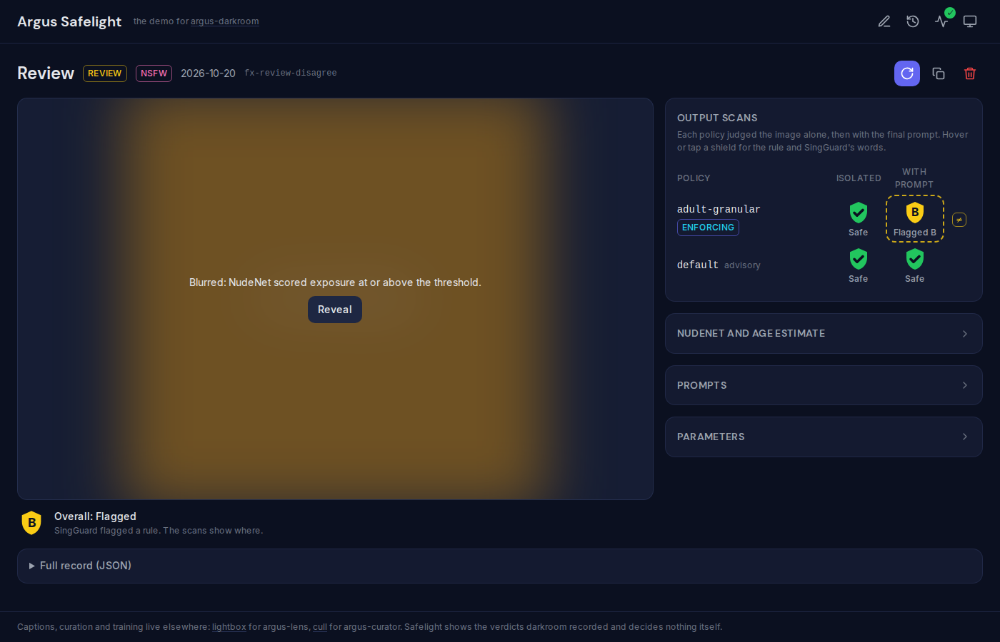
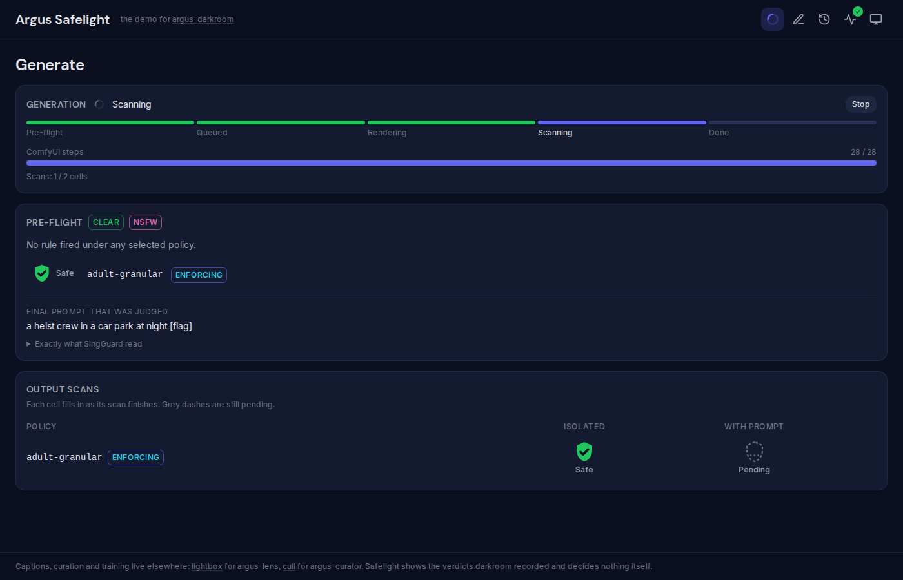
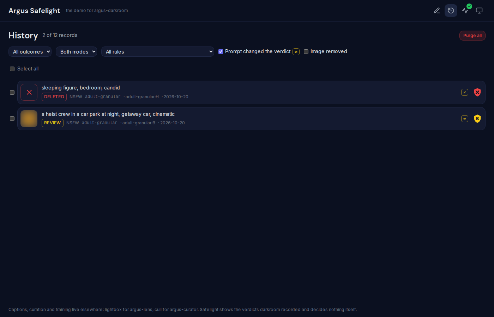
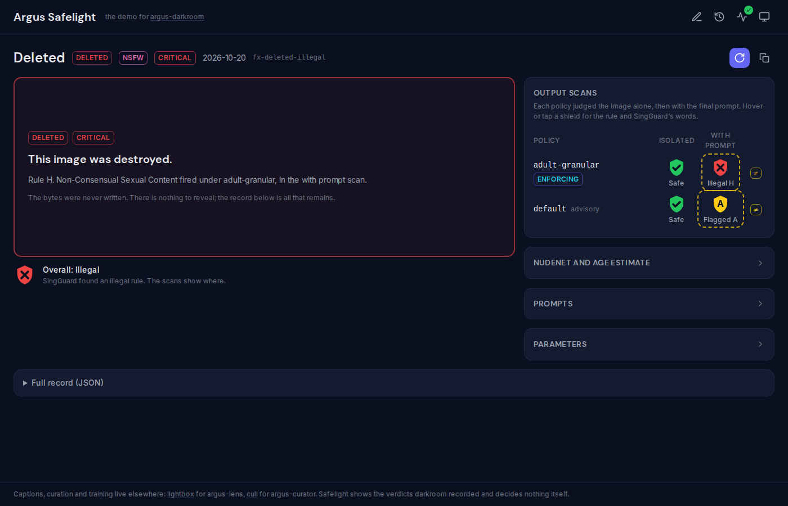
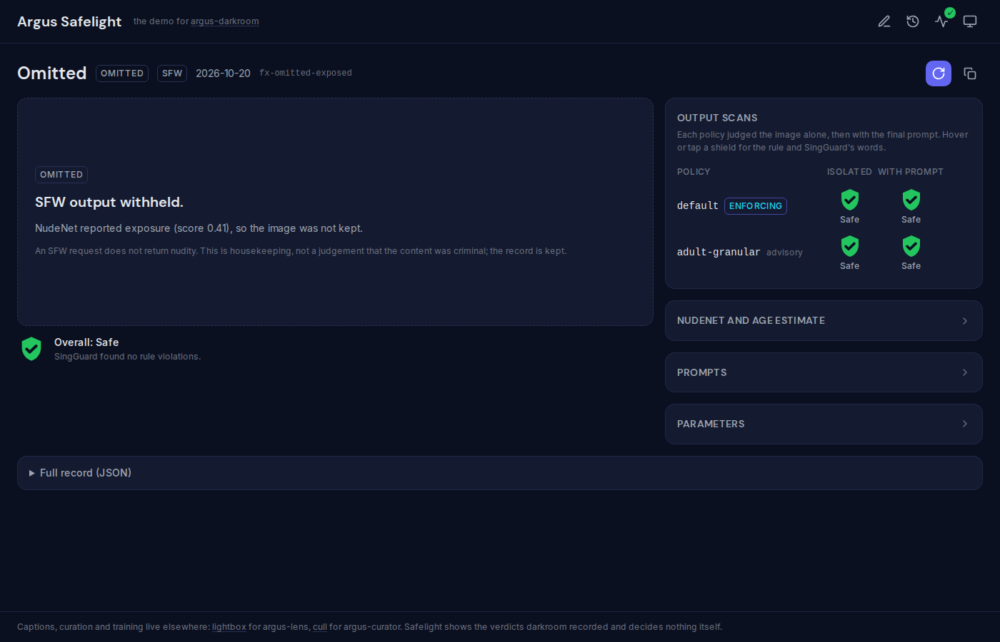

# Argus Safelight

The standalone demo UI for [argus-darkroom](https://github.com/smk762/argus-darkroom), the way [Lightbox](https://github.com/smk762/argus-lightbox) is for argus-lens and [Cull](https://github.com/smk762/argus-cull) is for argus-curator. You write a prompt, see the pre-flight verdict, generate, and see what each guard said about the output. Images that darkroom destroyed show as their record, never as pixels.

The server is the product. Safelight is a client: it shows the verdicts darkroom recorded and decides nothing itself.



| Generating: the grid fills in as the scans land | History, filtered to "Prompt changed the verdict" |
|---|---|
|  |  |

## What it shows

- **Compose.** A dialog opened from the header, so the record you are reading stays put. Prompt and negative prompt, checkpoint (starting on the one `GET /models` names as `default_checkpoint`) and LoRAs with weights, sampler, scheduler, steps, cfg, size, a seed that is random or locked, Ollama expansion, thinking mode and the NudeNet blur threshold. The **enforcing policy** is labelled and defaults to the server's; every policy carries the SFW or NSFW badge darkroom reports, and its wording and illegal rules are a click away. Choosing an NSFW enforcing policy states what changes. Advisory policies run for comparison only.
- **Pre-flight.** **Check** calls `POST /preflight` and shows one shield per policy, the rule and SingGuard's explanation for anything that is not green, and the final prompt that was judged. It judges the prompt as written: darkroom expands only at generation, then judges the expansion before rendering, and the live view shows what it added. A refusal says which rule fired, under which policy.
- **Generate.** Progress from the SSE stream: pre-flight, queued, the ComfyUI step bar, then one event per finished scan cell. The shield grid fills in cell by cell. Generate is offered only when `GET /health` answers and reports darkroom writable (not `read_only`), SingGuard and ComfyUI reachable, and, under an SFW enforcing policy, NudeNet available (`sfw_available`); when `/models` has a workflow that renders the chosen checkpoint with that many LoRAs in that mode (text, image-to-image or inpainting); when a record's input image has been chosen again; and when the prompt is not empty. The first condition that fails is named under the buttons and in Generate's hover text. A read-only darkroom disables **Check** too.
- **Result.** One view per outcome. *passed* and *review* show the image, blurred when darkroom said so until you reveal it. *deleted* is a tile with no image that names the rule, policy and scan context that fired. *omitted* is a plainer tile saying the SFW output was withheld because NudeNet reported exposure, or did not answer; it looks unlike deleted on purpose. *refused* shows the pre-flight panel. *failed* shows the error. Every view ends in the full record.
- **The shield grid.** Each policy judged the image alone and with the final prompt. Green tick, amber rule letter, red cross, grey question mark: a mark and a label on every shield, so colour is never the only signal. A **≠** badge marks a row whose two verdicts disagree, and a dashed outline marks a with-prompt cell where the prompt alone turned a green. Hover or tap for the rule, SingGuard's words and the thinking mode that answered.
- **Age estimates** appear only as "MiVOLO estimate: 34", one line per face, with hover text saying it is an automated guess that can be wrong. A deletion for `minor-exposed` says it was triggered by a MiVOLO age estimate under 18 together with NudeNet exposure.
- **Regenerate** refills the form from any record, holding its seed when it kept one. A record refused in pre-flight usually kept no seed and resolved no models: Regenerate refills its prompt and policies, leaves the seed random, and keeps the form's own checkpoint, LoRAs and sampling. **Copy record** copies the JSON. **Remove image** asks darkroom to delete the file and keeps the record.
- **History** is where the app opens, from `GET /records`, filtered by outcome and mode, by the rule that fired (grouped by policy, since a letter means something different under each), and by **Prompt changed the verdict**: the records where a policy's isolated and with-prompt scans disagree, which is the comparison darkroom exists to show. Tick rows to remove their images, which keeps the records, or under `devmode` to purge the records too. A removed image is marked in the list and has its own filter. The URL holds the filter; a result's URL holds the record id. History loads at most 200 records at once (darkroom's page limit); outcome and mode are asked of darkroom, but the rule, **Prompt changed the verdict** and image-removed filters, and **Select all**, see only the loaded page, and a notice says so when darkroom holds more.
- **Docs.** The book icon opens darkroom's own docs at `/docs`, imported from its `dev` branch (README and the reference sections of `spec.md`) and labelled with the version and commit, with links to PyPI, GitHub at that commit and the changelog. The shield grid, every outcome, the policy picker and expansion link into them, and every record says which darkroom judged it: "Judged by argus-darkroom 0.1.4.dev18+g3cf0818, policy adult-granular, thinking cascade", read from the record.
- **Purge all** exists only when `/health` reports `devmode`. The dialog counts what goes, offers the archive download first, and stays disabled until you type `purge`.

| A deleted record | An omitted record |
|---|---|
|  |  |

## What it does not show

- Pixels, a thumbnail or a placeholder for a deleted image. There is nothing to show, and nothing is drawn that suggests the content.
- A second decision. Outcomes and cell states come from the record; the browser does not reclassify rules or apply thresholds of its own. Changing the blur threshold changes the request sent to darkroom.
- File paths. Images load by record id, `GET /image/{id}`.
- Captions, curation or training. The footer links to Lightbox and Cull.

## Running it

What this UI needs live, what its mock or recording stands in for, and the no-GPU command are in [What to run for which UI](https://studio.dragonhound.dev/docs/setup/which-services/#safelight). Each external service it depends on has a setup page under the suite's [Setup and services](https://studio.dragonhound.dev/docs/setup/).

```
browser ──▶ safelight :3097 ──▶ argus-darkroom :8106
            compose, shields,     preflight, generate (SSE),
            history               records, images by id
```

With Docker, against the fixture mock (no GPU). `.env.example` sets `COMPOSE_PROFILES=mock`:

```bash
cp .env.example .env
docker compose up --build
```

Open <http://localhost:3097> (`PORT` in `.env` changes it). The mock serves the committed fixture on :8106 and generates new records on demand, with the verdict chosen by a marker in the prompt:

| Marker | What the mock does | Outcome |
|---|---|---|
| `[flag]` | the with-prompt scan flags rule B under the enforcing policy | review, scans disagree |
| `[flag-both]` | both scans flag | review, scans agree |
| `[illegal]` | the with-prompt scan hits an illegal rule | deleted |
| `[unchecked]` | the enforcing with-prompt scan fails | deleted (fails closed) |
| `[exposed]` | NudeNet scores 0.41 | omitted under SFW, blurred under NSFW |
| `[nonude]` | NudeNet does not answer | omitted under SFW, blurred under NSFW |
| `[minor]` | a MiVOLO estimate of 17 with NudeNet 0.45 | deleted, minor-exposed |
| `[noage]` | no age check on the record | |
| `[refuse]` | pre-flight flags a non-illegal rule | refused under SFW, a warning under NSFW |
| `[refuse-illegal]` | pre-flight hits an illegal rule | refused |
| `[preflight-unchecked]` | the pre-flight check fails | refused, unchecked |
| `[fail]` | ComfyUI fails mid-way | failed |
| `[input-exposed]` | with an input image: NudeNet scores the input 0.41 | refused (`input image: sfw-exposed`) under SFW; the input passes under NSFW |
| `[input-illegal]` | with an input image: the input's isolated scan hits an illegal rule | refused, critical (use an adult policy) |

Markers combine: `[illegal] [minor]` under an adult policy is deleted with both reasons on the tile.

`.env` also switches the mock's backends off one at a time (`MOCK_OLLAMA=0`, `MOCK_SINGGUARD=0`, …) to see how the page behaves without them, and `DEVMODE=0` hides Purge all, the same name darkroom's compose maps to `ARGUS_DARKROOM_DEVMODE`.

Against a live darkroom, omit `COMPOSE_PROFILES` and set `NEXT_PUBLIC_DARKROOM_URL` to that server before building. It is baked into the web image, so a change needs `docker compose up --build`. With a `localhost` URL the host follows the page: a page opened at this machine's LAN address calls that address on the URL's port. Every page carries a Content-Security-Policy that lets the browser reach that darkroom origin and no other, so a darkroom behind a different address than the baked-in URL (a reverse proxy, say) needs a rebuild with that URL, not just a redirect. In darkroom's own compose file, safelight runs beside the published darkroom image.

To try the UI against the real darkroom server with no GPU, run darkroom's demo (`make demo` in the argus-darkroom repo). It serves the same wire shapes on :8106 against fake backends, with the same prompt markers as the mock. LoRA trigger words you enter per LoRA are sent in the request, appended to the final prompt by darkroom after any expansion, and kept in the record, so a record refills the form with them. Darkroom chooses its ComfyUI workflow per generation by the checkpoint's family folder (`sdxl/`, `flux/`, `flux-klein/`, `sd35/`) and the number of LoRAs, and the form follows `/models`: checkpoints are grouped by family, one with no workflow is listed but cannot be picked, LoRAs stop at the family's limit, a Guidance field appears for Flux and the negative prompt disappears where the workflow has no slot for it. Changing family moves the sampling to that family's usual starting values. The mock does the same with the fixture's `sdxl/`, `flux/`, `flux-klein/`, `sd35/` and template-less `pony/` checkpoints, and answers 400 where darkroom would.

**Image-to-image and inpainting.** Where the checkpoint has a template for it (`img2img_lora_counts`, `inpaint_lora_counts` in `/models`; SDXL with 0 or 1 LoRA in darkroom's examples), the form takes an input image, picked or dropped: PNG, JPEG or WebP, up to 16 MiB and 4096 px a side, checked in the browser before it is sent. Denoise runs from 0.05 to 1. A mask turns it into inpainting: paint it over the preview (brush, eraser, invert) or upload one the input's size, white where it repaints. The input gets an output's checks before anything renders, shown live as its own row of shields, and only a passed input goes on; a refused one ends the attempt as `input image: <reason>`. The pixels stay in the page's memory: nothing is written to browser storage, pre-flight is sent without them (darkroom judges the text alone there), and darkroom keeps only hashes, so a record shows the input's size, denoise, hashes and mask share, never a picture, and Regenerate asks for the image again.

For development:

```bash
make install   # npm ci (in node:22 via Docker when there is no host Node)
make mock      # the fixture mock on :8106
make dev       # next dev on :3097 (PORT)
make check     # lint + typecheck + test + build, what CI runs
make fixture   # redraw fixture/ (needs uv)
make sync      # move to darkroom's dev HEAD: schema, wire types, docs, fixture (network; needs uv)
```

`next dev` serves its own assets only to `localhost`. To open the dev page from a LAN address, list the hostnames it is opened as in `SAFELIGHT_DEV_ORIGINS`, comma-separated (`SAFELIGHT_DEV_ORIGINS=<LAN_HOST> make dev`). Production (`next start`, the Docker image) needs nothing.

## Keeping in step with darkroom

Safelight tracks argus-darkroom's `dev` HEAD, never an old release. One sync record, [`web/schema/pins.json`](web/schema/pins.json), holds darkroom's repo, the `dev` commit, the package version at that commit (hatch-vcs's, e.g. `0.1.4.dev18+g3cf0818`) and a sha256 per imported file. From it:

- **Wire types.** `web/src/lib/generated/darkroom.ts` is generated from darkroom's `schema/darkroom-wire.schema.json` at that commit (`make wire`), and `types.ts` re-exports the record types from it. `/health`, `/policies`, `/models`, the request and the stream events are not in darkroom's schema yet and stay hand-written.
- **Docs.** `web/content/darkroom/` holds darkroom's `README.md` and `spec.md` exactly as they are at that commit. `/docs` renders them on the server as React elements: no raw HTML, no runtime fetch, no new CSP source. Links into darkroom's repo go to GitHub at the commit, and remote images (badges) are dropped.
- **Fixture.** `fixture/darkroom.json` and every record's `darkroom_version` say which darkroom the fixture was recorded against.

`make lint` (and CI) fails when any of them disagree with the record: a doc or the schema edited by hand, types not regenerated, or a fixture at another version. `make sync` moves everything to darkroom's `dev` HEAD in one step. It runs every fetched file through an opsec gate first, which refuses (and never redacts) private or link-local addresses, home and server paths, email addresses and any term in the `OPSEC_DENYLIST` environment variable (a CI secret, never committed). A scheduled workflow (`.github/workflows/darkroom-drift.yml`) does the same every day and opens a pull request when darkroom has moved, or an issue when the pull fails.

## The fixture

`fixture/` holds a record for every outcome and flat colour images for the ones that keep an image. The verdicts are written by hand to exercise the UI, not earned by the pictures, and nothing flagged, sexual or violent goes in the repo. See [fixture/README.md](fixture/README.md).

## Licence

MIT.
