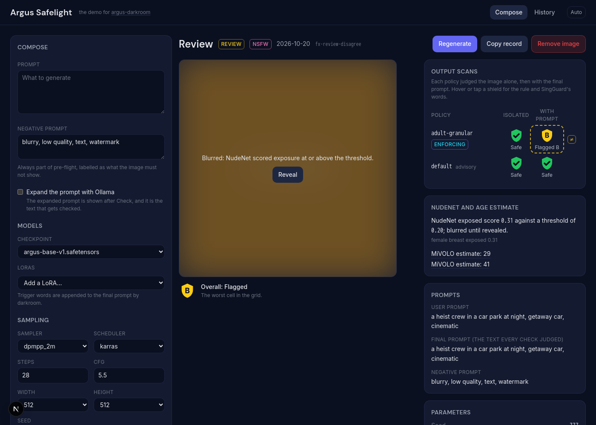
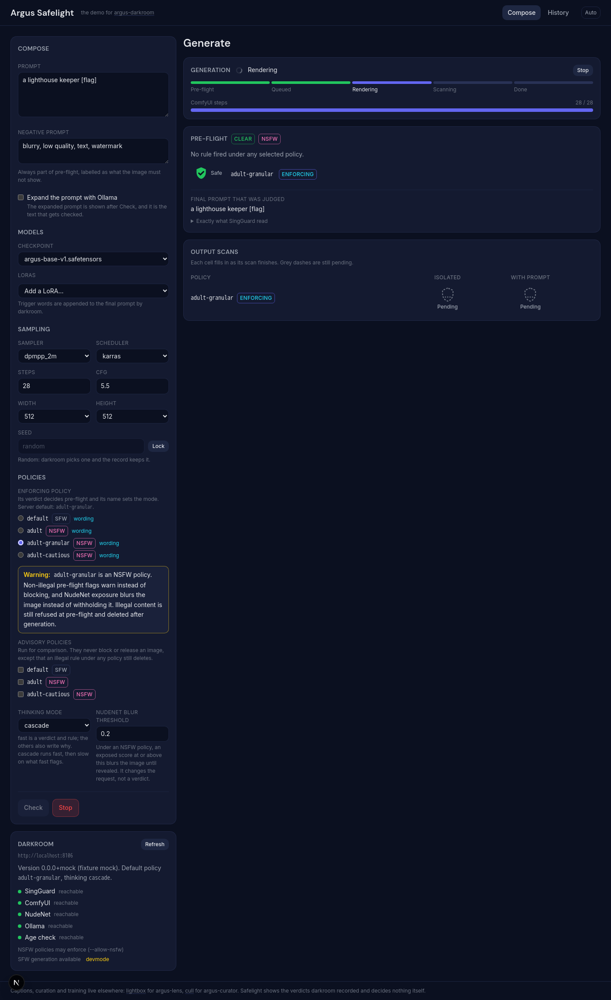
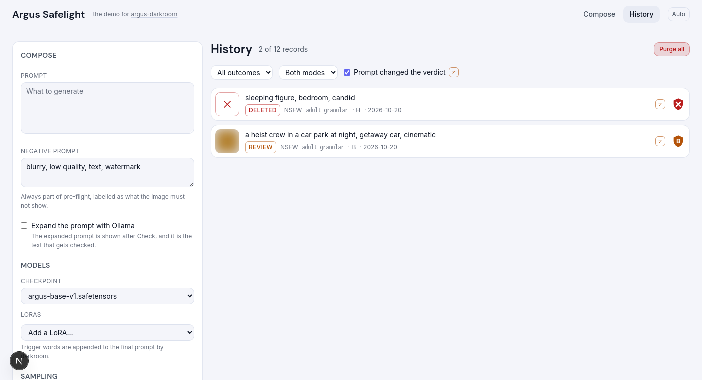
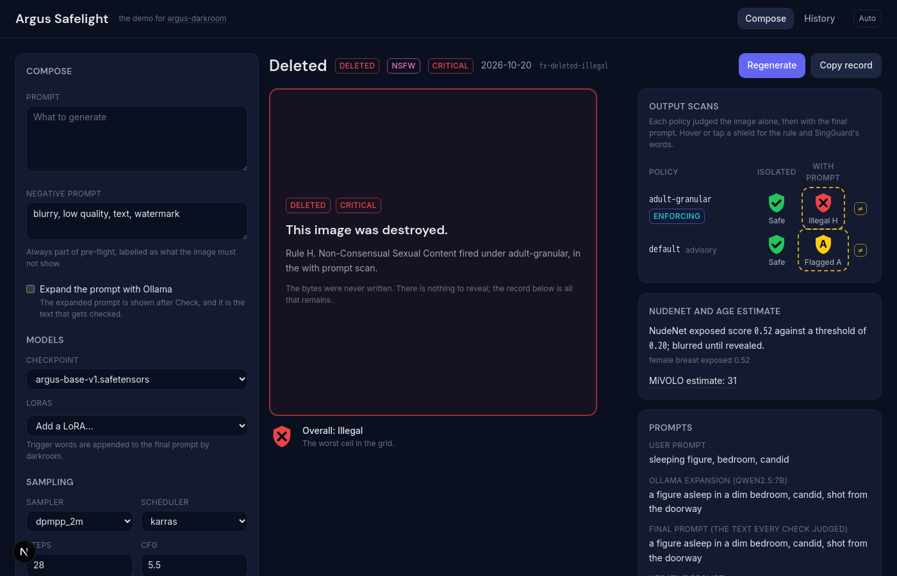
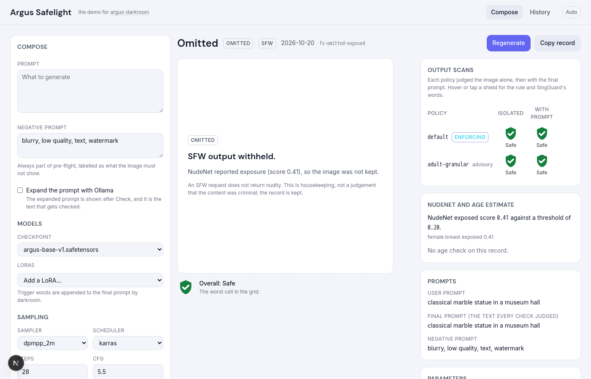

# Argus Safelight

The standalone demo UI for [argus-darkroom](https://github.com/smk762/argus-darkroom), the way [Lightbox](https://github.com/smk762/argus-lightbox) is for argus-lens and [Cull](https://github.com/smk762/argus-cull) is for argus-curator. You write a prompt, see the pre-flight verdict, generate, and see what each guard said about the output. Images that darkroom destroyed show as their record, never as pixels.

The server is the product. Safelight is a client: it shows the verdicts darkroom recorded and decides nothing itself.



| Generating: the grid fills in as the scans land | History, filtered to "Prompt changed the verdict" |
|---|---|
|  |  |

## What it shows

- **Compose.** A dialog opened from the header, so the record you are reading stays put. Prompt and negative prompt, checkpoint and LoRAs with weights (`GET /models`), sampler, scheduler, steps, cfg, size, a seed that is random or locked, Ollama expansion, thinking mode and the NudeNet blur threshold. The **enforcing policy** is labelled and defaults to the server's; every policy carries the SFW or NSFW badge darkroom reports, and its wording and illegal rules are a click away. Choosing an NSFW enforcing policy states what changes. Advisory policies run for comparison only.
- **Pre-flight.** **Check** calls `POST /preflight` and shows one shield per policy, the rule and SingGuard's explanation for anything that is not green, and the final prompt that was judged, so you see what expansion added. A refusal says which rule fired, under which policy.
- **Generate.** Progress from the SSE stream: pre-flight, queued, the ComfyUI step bar, then one event per finished scan cell. The shield grid fills in cell by cell. Generate is offered only after `GET /health` reports SingGuard reachable.
- **Result.** One view per outcome. *passed* and *review* show the image, blurred when darkroom said so until you reveal it. *deleted* is a tile with no image that names the rule, policy and scan context that fired. *omitted* is a plainer tile saying the SFW output was withheld because NudeNet reported exposure, or did not answer; it looks unlike deleted on purpose. *refused* shows the pre-flight panel. *failed* shows the error. Every view ends in the full record.
- **The shield grid.** Each policy judged the image alone and with the final prompt. Green tick, amber rule letter, red cross, grey question mark: a mark and a label on every shield, so colour is never the only signal. A **≠** badge marks a row whose two verdicts disagree, and a dashed outline marks a with-prompt cell where the prompt alone turned a green. Hover or tap for the rule, SingGuard's words, the thinking mode and the cascade's fast verdict.
- **Age estimates** appear only as "MiVOLO estimate: 34", one line per face, with hover text saying it is an automated guess that can be wrong. A deletion for `minor-exposed` says it was triggered by a MiVOLO age estimate under 18 together with NudeNet exposure.
- **Regenerate** refills the form from any record, seed held. **Copy record** copies the JSON. **Remove image** asks darkroom to delete the file and keeps the record.
- **History** from `GET /records`, filtered by outcome and mode, and by **Prompt changed the verdict**: the records where a policy's isolated and with-prompt scans disagree, which is the comparison darkroom exists to show. The URL holds the filter; a result's URL holds the record id.
- **Purge all** exists only when `/health` reports `devmode`. The dialog counts what goes, offers the archive download first, and stays disabled until you type `purge`.

| A deleted record | An omitted record |
|---|---|
|  |  |

## What it does not show

- Pixels, a thumbnail or a placeholder for a deleted image. There is nothing to show, and nothing is drawn that suggests the content.
- A second decision. Outcomes and cell states come from the record; the browser does not reclassify rules or apply thresholds of its own. Changing the blur threshold changes the request sent to darkroom.
- File paths. Images load by record id, `GET /image/{id}`.
- Captions, curation or training. The footer links to Lightbox and Cull.

## Running it

```
browser ──▶ safelight :3097 ──▶ argus-darkroom :8106
            compose, shields,     preflight, generate (SSE),
            history               records, images by id
```

With Docker, against the fixture mock (no GPU):

```bash
cp .env.example .env
docker compose up --build
```

Open <http://localhost:3097> (`PORT` in `.env` changes it). The mock serves the committed fixture on :8106 and generates new records on demand, with the verdict chosen by a marker in the prompt:

| Marker | What the mock does | Outcome |
|---|---|---|
| `[flag]` | the with-prompt scan flags rule B under the enforcing policy | review, scans disagree |
| `[flag-both]` | both scans flag | review, scans agree |
| `[illegal]` | the with-prompt scan hits an illegal rule | deleted |
| `[unchecked]` | the enforcing with-prompt scan fails | deleted (fails closed) |
| `[exposed]` | NudeNet scores 0.41 | omitted under SFW, blurred under NSFW |
| `[nonude]` | NudeNet does not answer | omitted under SFW, blurred under NSFW |
| `[minor]` | a MiVOLO estimate of 17 with NudeNet 0.45 | deleted, minor-exposed |
| `[noage]` | no age check on the record | |
| `[refuse]` | pre-flight flags a non-illegal rule | refused under SFW, a warning under NSFW |
| `[refuse-illegal]` | pre-flight hits an illegal rule | refused |
| `[preflight-unchecked]` | the pre-flight check fails | refused, unchecked |
| `[fail]` | ComfyUI fails mid-way | failed |

`.env` also switches the mock's backends off one at a time (`MOCK_OLLAMA=0`, `MOCK_SINGGUARD=0`, …) to see how the page behaves without them, and `DEVMODE=0` hides Purge all, the same name darkroom's compose maps to `ARGUS_DARKROOM_DEVMODE`.

Against a real darkroom, set `NEXT_PUBLIC_DARKROOM_URL` before building. It is baked into the web image, so a change needs `docker compose up --build`. With a `localhost` URL the host follows the page: a page opened at this machine's LAN address calls that address on port 8106. In darkroom's own compose file, safelight runs beside the published darkroom image.

For development:

```bash
make install   # npm ci (in node:22 via Docker when there is no host Node)
make mock      # the fixture mock on :8106
make dev       # next dev on :3097 (PORT)
make check     # lint + typecheck + test + build, what CI runs
make fixture   # redraw fixture/ (needs uv)
```

## The fixture

`fixture/` holds a record for every outcome and flat colour images for the ones that keep an image. The verdicts are written by hand to exercise the UI, not earned by the pictures, and nothing flagged, sexual or violent goes in the repo. See [fixture/README.md](fixture/README.md).

## Licence

MIT.
